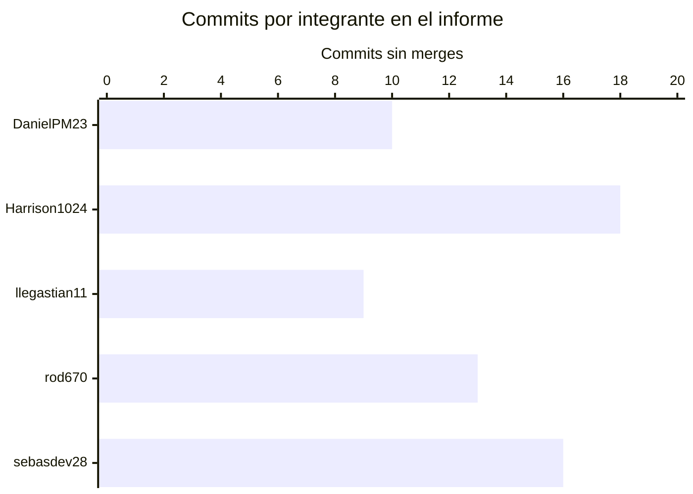

# Registro de Versiones del Informe

| Versión | Fecha | Autor | Descripción de modificación |
|---|---|---|---|
| 0.1.0 | 2026-09-02 | BLIP | Estructura inicial del informe en Markdown hasta Capítulo V. |
| 0.2.0 | 2026-09-13 | Reyes Limo, Sebastian Eduardo | Desarrollo del Capítulo II, evidencias de Needfinding, Big Picture Event Storming y mejora del Ubiquitous Language. |
| 0.3.0 | 2026-09-20 | Reyes Limo, Sebastian Eduardo | Corrección de los datos de colaboración del `README.md` (códigos y usuarios de GitHub), incorporación de los enlaces de los repositorios del proyecto, actualización de los roles y del estado de AV1, conclusiones del Student Outcome por integrante y cierre de los entregables del plan AV1. Se agregó el video About-the-Team y se completaron las evidencias de ejecución del Capítulo V (US01 a US04) y los anexos de entrevistas y de navegación del prototipo. |

| 0.4.0 (revisión AV2) | 2026-11-11 | BLIP | Ajustes de formato, evidencia local de Sprint 2, revisión de criterios y registro inicial de dos entrevistas de validación. No corresponde al cierre de AV2. |

# Project Report Collaboration Insights

## Repositorio

URL del repositorio del informe: https://github.com/upc-pre-202620-asi0730-8088-blip/fleetproof-report

## Estrategia de colaboración

El equipo BLIP elaborará el informe en Markdown usando GitHub como sistema de control de versiones. El archivo principal será `README.md` y cada capítulo tendrá un archivo independiente en `docs/`, con el fin de reducir conflictos de edición y evidenciar aportes individuales.

## Evidencias por entrega

| Entrega | Evidencia requerida | Estado |
|---|---|---|
| AV1 | Commits, ramas, Pull Requests, merges y capturas de colaboración del informe. | Completado: 6 Pull Requests mergeados en `develop`, release `v1.0.0` de la Landing Page, despliegue en GitHub Pages y video About-the-Team. |
| TB1 | Actualización de commits, mejoras sobre feedback y nueva versión del informe. | Evidencia no incorporada en esta versión |
| AV2 | Evidencias ampliadas de colaboración, validación y mejoras. | Evidencia no incorporada en esta versión |
| TB2 | Evidencia final de colaboración durante todo el ciclo. | Evidencia no incorporada en esta versión |

## Distribución de commits del informe

Corte del 11 de noviembre de 2026. Historial acumulado de [`develop` en `fbc08a9`](https://github.com/upc-pre-202620-asi0730-8088-blip/fleetproof-report/commit/fbc08a9a4728af039b57e652de024e6bf0a2b761): 66 commits de autoría, sin contar merges. Fuente: API de GitHub. El gráfico no atribuye estos commits al Sprint 3.

Valores en el orden del gráfico: DanielPM23 (10), Harrison1024 (18), llegastian11 (9), rod670 (13) y sebasdev28 (16). Para la evidencia por entrega, adjuntar las capturas nativas de [Contributors](https://github.com/upc-pre-202620-asi0730-8088-blip/fleetproof-report/graphs/contributors) y [Commit activity](https://github.com/upc-pre-202620-asi0730-8088-blip/fleetproof-report/graphs/commit-activity), con la rama y el período consultados. El gráfico de arriba es una elaboración del equipo a partir del historial, no una captura de esas pantallas.

## Convenciones de GitFlow

| Tipo | Convención |
|---|---|
| Main branch | `main` |
| Development branch | `develop` |
| Documentation branch | `docs/<scope>` |
| Feature branch | `feature/usXXX-<short-name>` |
| Release branch | `release/vX.Y.Z` |
| Hotfix branch | `hotfix/<short-name>` |

## Versiones requeridas por producto

| Producto | Releases requeridos |
|---|---|
| Landing Page | `v1.0.0`, `v2.0.0`, `v3.0.0`, `v4.0.0` |
| Frontend Web Application | `v1.0.0`, `v2.0.0`, `v3.0.0` |
| Web Services | `v1.0.0`, `v2.0.0` |
