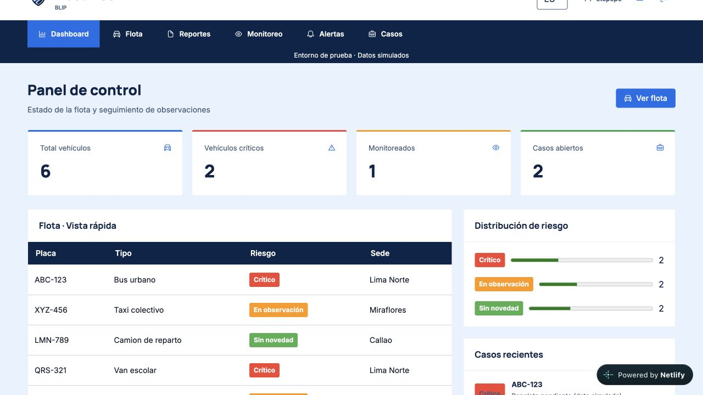
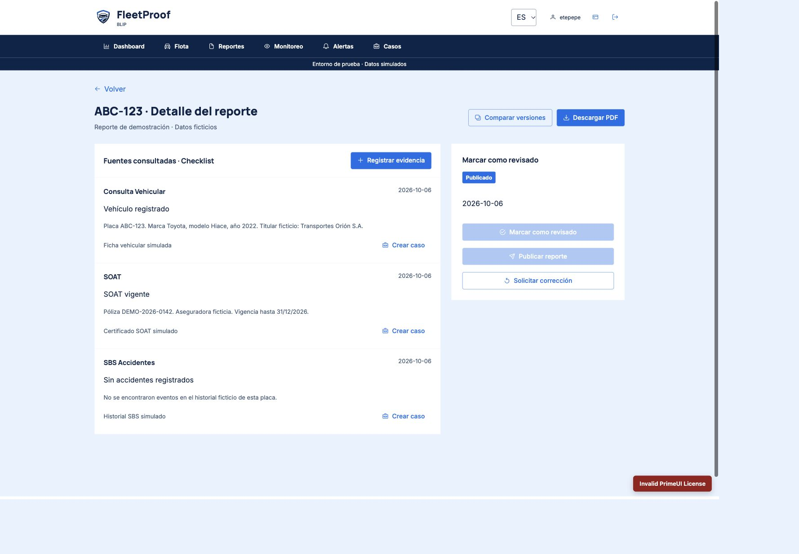
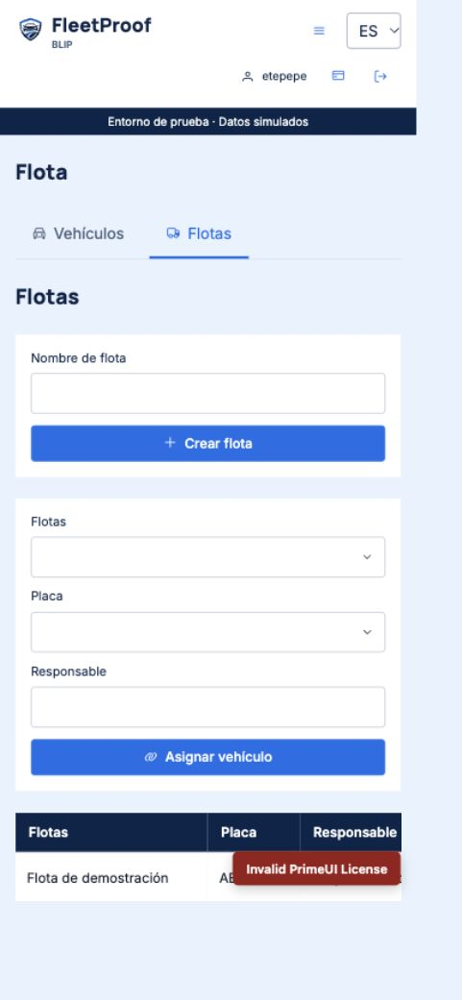
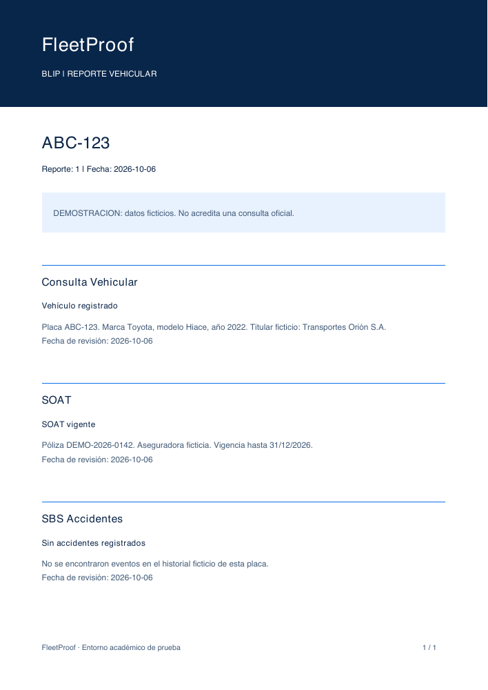
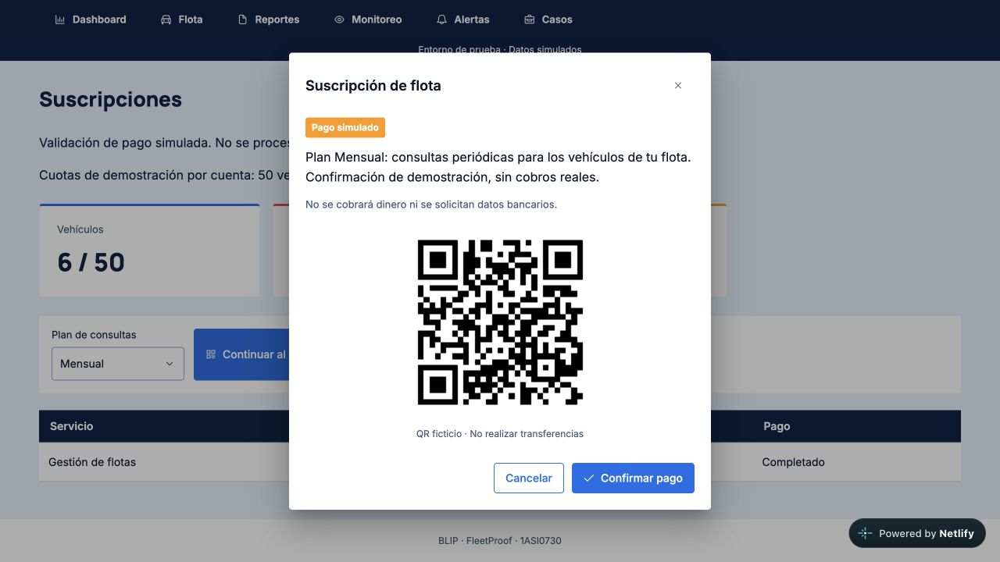
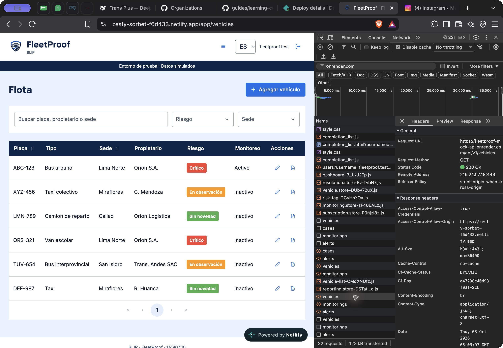
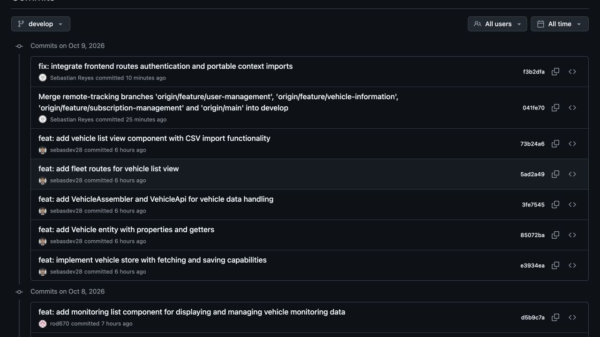

# Capítulo V: Product Implementation, Validation & Deployment

## 5.1 Software Configuration Management

### 5.1.1 Software Development Environment Configuration

En esta sección se detallan las herramientas y plataformas de software adoptadas por el equipo para coordinar, diseñar, implementar y documentar el ciclo de vida del producto digital. Se especifican el propósito de uso de cada herramienta, su tipo de ejecución y la ruta de acceso o descarga oficial correspondiente:

| Herramienta / Software | Tipo / Modelo | Propósito en el Proyecto | Actividad Asociada | Enlace de Referencia / Acceso |
| :--- | :--- | :--- | :--- | :--- |
| **Miro** | SaaS (Nube) | Plataforma de pizarra visual colaborativa utilizada para la realización de las dinámicas de *EventStorming* (Big Picture y Design-Level), mapeo de procesos de negocio y exploración visual del dominio. | Requirements Management & Domain Modeling | [https://miro.com/](https://miro.com/) |
| **Figma** | SaaS (Nube) | Herramienta de diseño de interfaces vectoriales y prototipado empleada para definir la guía de estilos visuales, *wireframes*, *mock-ups* y los flujos de interacción del *Landing Page* y la aplicación web. | Product UX/UI Design | [https://figma.com/](https://figma.com/) |
| **HackMD (HackMD.io)** | SaaS (Nube) | Entorno de edición colaborativa en tiempo real en formato Markdown, utilizado para redactar, revisar y sincronizar colectivamente el contenido de las secciones del informe de proyecto. | Project Documentation & Reporting | [https://hackmd.io/](https://hackmd.io/) |
| **GitHub** | SaaS (Nube) | Plataforma de alojamiento de repositorios Git utilizada para la gestión centralizada del código fuente, aplicación del flujo *GitFlow*, seguimiento de *commits*, métricas de contribución y control de versiones del informe del proyecto. | Source Code Management & Collaboration | [https://github.com/](https://github.com/) |

### 5.1.2 Source Code Management

Para garantizar la integridad, trazabilidad y el trabajo colaborativo en el desarrollo de la solución, el equipo utiliza **GitHub** como plataforma centralizada de alojamiento y control de versiones bajo Git.

##### Repositorios del Proyecto

| Producto / Artefacto | Propósito | Enlace al Repositorio en GitHub |
| :--- | :--- | :--- |
| **Project Documentation Report** | Repositorio para la elaboración colaborativa del informe técnico del proyecto en formato Markdown. | [blip-fleetproof-project-report](https://github.com/1ASI0730-8088-Blit/blip-fleetproof-project-report) |
| **Landing Page** | Repositorio del sitio web estático para la presentación comercial y conversión del modelo de negocio. | [fleetproof-landing-page](https://github.com/1ASI0730-8088-Blit/fleetproof-landing-page) |
##### Flujo de Ramas: GitFlow Workflow

El equipo implementa el modelo de flujo de trabajo **GitFlow**, estructurando el ciclo de desarrollo a través de ramas principales y ramas temporales de soporte:

1. **Ramas Principales:**
   * `main`: Contiene el código fuente en estado de producción, estable y totalmente desplegable. Todo cambio en esta rama proviene exclusivamente de fusiones validadas de ramas de lanzamiento (*release*) o parches urgentes (*hotfix*).
   * `develop`: Actúa como la rama de integración continua y base para el desarrollo diario. En ella se consolidan todas las funcionalidades culminadas y revisadas que formarán parte de la siguiente iteración.

2. **Ramas de Soporte:**
   * `feature/<nombre-de-tarea>`: Se desprenden de `develop` para la construcción aislada de una historia de usuario, componente de interfaz o sección de documentación. Una vez completada y verificada la tarea, se integra nuevamente en `develop` a través de un *Pull Request* con revisión previa de pares.
     * *Convención para desarrollo de software:* `feature/<US-ID>-<short-description>` (Ejemplo: `feature/US01-landing-hero`, `feature/US02-pricing-cards`).
     * *Convención para informe de proyecto:* `feature/sprint<n>-capitulo-<id>` (Ejemplo: `feature/sprint1-capitulo-5`).
   * `release/v<MAJOR.MINOR.PATCH>`: Se crean a partir de `develop` al alcanzar el congelamiento de características planeadas para un hito de entrega (Sprint Review). Sirven para realizar pruebas de aceptación finales, ajustes menores de documentación y preparar el despliegue. Se fusionan hacia `main` (etiquetando el lanzamiento) y de vuelta hacia `develop`.
   * `hotfix/v<MAJOR.MINOR.PATCH>`: Se desprenden directamente de `main` en caso de requerir la corrección crítica e inmediata de un defecto en el entorno de producción. Se fusionan simultáneamente a `main` y a `develop`.

##### Versionado Semántico (Semantic Versioning 2.0.0)

Para el control de versiones y etiquetado de los lanzamientos oficiales (*releases*), se adopta el estándar **SemVer 2.0.0** bajo la nomenclatura `vMAJOR.MINOR.PATCH`:

* **MAJOR:** Incrementa ante cambios incompatibles con versiones previas (*breaking changes*) o entregas de arquitectura estructurales mayores (Ejemplo: transición de entregas mayores finales).
* **MINOR:** Incrementa cuando se añaden nuevas funcionalidades, vistas o endpoints que son compatibles con las versiones existentes hacia atrás (Ejemplo: cierre de un nuevo Sprint como `v0.1.0` para Sprint 1, `v0.2.0` para Sprint 2).
* **PATCH:** Incrementa cuando se introducen correcciones de errores, ajustes de accesibilidad o parches menores que no alteran la compatibilidad previa (Ejemplo: `v0.1.1`).

##### Convención de Mensajes: Conventional Commits

Para mantener un historial de confirmaciones (*commits*) claro, legible y automatizable, los mensajes deben redactarse en idioma inglés siguiendo la especificación de **Conventional Commits**:

* **Estructura obligatoria:**
  ```text
  <type>(<scope>): <short description in present tense>

### 5.1.3 Source Code Style Guide & Coding Conventions

Para garantizar la legibilidad, mantenibilidad y consistencia del código fuente a lo largo del ciclo de vida del proyecto, el equipo adopta estándares oficiales de codificación reconocidos en la industria.

Como principio general, todos los identificadores en el código (nombres de archivos, variables, funciones, métodos, clases, interfaces, comentarios en el código y mensajes de error o registros) deben redactarse estrictamente en idioma inglés.

##### Convenciones Generales de Nomenclatura

| Lenguaje / Tecnología | Elemento de Código | Convención de Nomenclatura | Ejemplo |
| :--- | :--- | :--- | :--- |
| **HTML5** | Nombres de etiquetas y atributos | lowercase | `<section class="hero">`, `` |
| **CSS3** | Clases y selectores | kebab-case | `.btn-primary`, `.vehicle-card-header` |
| **JavaScript / Vue** | Variables y funciones | camelCase | `licensePlate`, `fetchVehicleReports()` |
| **JavaScript / Vue** | Constantes globales | UPPER_SNAKE_CASE | `API_BASE_URL`, `DEFAULT_TIMEOUT` |
| **JavaScript / Vue** | Componentes Vue y Clases | PascalCase | `VehicleReport.vue`, `RiskAssessmentService` |
| **C# (.NET Core)** | Clases, Registros y Structs | PascalCase | `Vehicle`, `ReportService` |
| **C# (.NET Core)** | Interfaces | PascalCase con prefijo 'I' | `IVehicleRepository`, `INotificationService` |
| **C# (.NET Core)** | Métodos y Propiedades | PascalCase | `GetByIdAsync()`, `LicensePlate` |
| **C# (.NET Core)** | Variables locales y parámetros | camelCase | `reportId`, `cancellationToken` |
| **C# (.NET Core)** | Campos privados de clase | _camelCase (guion bajo) | `_dbContext`, `_logger` |

##### Estándares por Lenguaje y Marco de Trabajo

###### 1. HTML5
Se adoptan las directrices de la *Google HTML/CSS Style Guide* y las especificaciones de *W3Schools*:
* **Semántica estructural:** Se prioriza el uso de elementos semánticos de HTML5 (`<header>`, `<nav>`, `<main>`, `<section>`, `<article>`, `<footer>`) en lugar de contenedores genéricos `<div>`.
* **Sintaxis limpia:** No se emplean mayúsculas en nombres de elementos o atributos. Todos los valores de atributos deben delimitarse con comillas dobles.
* **Accesibilidad (a11y):** Toda imagen debe incluir el atributo `alt` con una descripción textual representativa. Los elementos interactivos deben incluir atributos ARIA (`aria-label`, `aria-expanded`, etc.) cuando la semántica nativa resulte insuficiente.

###### 2. CSS3
Se adoptan las directrices de la *Google HTML/CSS Style Guide*:
* **Formato e indentación:** Se emplea una indentación consistente de 2 espacios sin tabulaciones.
* **Especificidad de selectores:** Se diseñan estilos basados en clases reutilizables (*kebab-case*). Se restringe estrictamente el uso de selectores de ID (`#`) para aplicar estilos y se evita el uso de declaraciones `!important`.
* **Diseño adaptativo:** Las reglas de visualización adaptable deben organizarse mediante consultas de medios (*Media Queries*) siguiendo el enfoque de diseño responsivo.

###### 3. JavaScript & Vue.js
Se adoptan las directrices de la *Google JavaScript Style Guide* y la *Vue Style Guide*:
* **Declaración de variables:** Se prohíbe el uso de la palabra clave `var`. Se utiliza `const` de manera predeterminada y `let` únicamente cuando la variable requiera reasignación.
* **Componentes Vue:** Los nombres de componentes de archivo único (*Single File Components*) deben estructurarse en *PascalCase* y constar de más de una palabra para evitar colisiones con elementos HTML nativos (por ejemplo, `ReportCard.vue` en lugar de `Card.vue`).
* **Manejo asíncrono:** Se prioriza el uso de la sintaxis `async/await` estructurada con bloques `try/catch` para el consumo de servicios asíncronos y llamadas HTTP.

###### 4. C# & ASP.NET Core
Se adoptan las directrices oficiales de *Microsoft C# Coding Conventions* y *Microsoft ASP.NET Core Coding Guidelines*:
* **Estructura y llaves:** Se sigue el estilo Allman para la apertura y cierre de bloques de código, colocando las llaves (`{ }`) en una línea independiente alineada con el nivel de indentación correspondiente (4 espacios).
* **Inyección de dependencias:** Los servicios y repositorios deben desacoplarse mediante interfaces inyectadas vía constructor, almacenándolos en campos privados de solo lectura (`private readonly`).
* **Operaciones asíncronas:** Todo método asíncrono debe llevar el sufijo `Async` (por ejemplo, `SaveVehicleAsync`) y recibir o propagar un token de cancelación (`CancellationToken`) cuando aplique.


### 5.1.4 Software Deployment Configuration

A continuación, se describen las especificaciones técnicas y los procedimientos de construcción y despliegue de FleetProof. La Landing Page utiliza GitHub Pages; la Web Application del Sprint 2 utiliza Netlify y consume una Fake API desplegada en Render. Esta API de demostración no sustituye los servicios backend de producción.

| Producto | Proveedor | Pasos de construcción y despliegue | Variables por nombre, sin secretos | URL y verificación |
|---|---|---|---|---|
| Landing Page | GitHub Pages | 1. Integración de los cambios terminados hacia la rama `main` mediante Pull Request aprobado.<br>2. En el repositorio de GitHub, navegar a **Settings** > **Pages**.<br>3. En la sección **Build and deployment** > **Source**, seleccionar **Deploy from a branch**.<br>4. En el menú desplegable de rama, elegir `main` y en la carpeta seleccionar `/ (root)`. Presionar **Save**.<br>5. GitHub ejecuta de manera automática el workflow de GitHub Actions denominado `pages-build-deployment`. | No aplica justificado. Al tratarse de un sitio web estático desarrollado con HTML5 semántico, CSS3 y JavaScript vanilla, los archivos son interpretados directamente por el navegador del cliente y no requieren variables de entorno ni compilación del lado del servidor. | URL: `https://1asi0730-8088-blit.github.io/fleetproof-landing-page/`<br>Verificación: Respuesta HTTP 200 OK, renderizado responsivo correcto, funcionamiento del selector de idioma (ES/EN), apertura y foco de los modales legales y visualización de notificaciones toast en las llamadas a la acción. |
| Frontend Web Application | Netlify | Vue.js / Vite; construcción con `npm run build`, publicación de `dist/` y redirección SPA. | `VITE_FLEETPROOF_API_URL`, `VITE_AUTH_MODE`, `VITE_PRIME_UI_LICENSE_KEY` | **Done (Sprint 2).** [Aplicación publicada](https://zesty-sorbet-f6d433.netlify.app/login). El panel de Netlify registra la publicación del 10 de octubre de 2026. Evidencia en 5.2.2.5 y 5.2.2.7. |
| Fake Web Services | Render | Node.js / JSON Server; contrato de demostración descrito en 5.2.2.6. | Consultar la configuración y el README del mock; no se publican secretos. | **Done (Sprint 2).** [Health check de la Fake API](https://fleetproof-mock-api.onrender.com/api/v1/health). No incluye fuentes oficiales, pagos reales ni base de datos de producción. |
| Web Services (backend real) | Validación local | ASP.NET Core, EF Core y PostgreSQL; no es el servicio de demostración de Render. | `ConnectionStrings__FleetProof`, `Cors__Origins__0` | Implementación verificada en local. Despliegue público no realizado. |

## 5.2 Landing Page, Services & Applications Implementation

### 5.2.1 Sprint 1

#### 5.2.1.1 Sprint Planning 1

El equipo llevó a cabo la sesión de Sprint Planning con el propósito de definir el objetivo central de la iteración, establecer el alcance operativo para el hito AV1 y seleccionar del Product Backlog las historias de usuario orientadas a la implementación, estilizado y despliegue del sitio web estático (Landing Page).

A continuación se presenta el resumen formal de la reunión de planificación del Sprint 1:

| Sprint # | Sprint 1 |
| :--- | :--- |
| **Sprint Planning Background** | |
| **Date** | 2026-08-30 |
| **Time** | 14:00 - 15:30 |
| **Location** | Sesión virtual vía Discord |
| **Prepared By** | Gómez De La Torre Huertas, Rodrigo Fernando |
| **Attendees (to planning meeting)** | Gómez De La Torre Huertas, Rodrigo  / reyes Limo, Sebastian / Palomino Murga, Daniel / Becerra Durand, Sebastian / Payesa Torres Harrison |
| **Sprint 0 Review Summary** | Al tratarse del primer sprint del ciclo de desarrollo, no existe un incremento de software previo sujeto a revisión formal. El equipo consolidó los requerimientos iniciales, los arquetipos de usuario y las directrices de diseño visual en Figma. |
| **Sprint 0 Retrospective Summary** | Como retrospectiva previa, el equipo acordó estandarizar el flujo de trabajo mediante ramas GitFlow y Conventional Commits para evitar conflictos de integración en el repositorio del informe y del producto. |
| **Sprint Goal & User Stories** | |
| **Sprint 1 Goal** | Publicar una página de inicio adaptable y accesible que explique la propuesta de FleetProof a responsables de flotas y propietarios particulares. Se verificará que ambos perfiles puedan comparar los planes, consultar las políticas legales y utilizar las llamadas a la acción correspondientes. |
| **Sprint 1 Velocity** | 11 Story Points |
| **Sum of Story Points** | 11 Story Points |

###### User Stories Comprometidas en el Sprint 1

Para cumplir con el Sprint Goal formulado, se incluyeron en el Sprint Backlog la totalidad de historias de usuario asociadas al Epic EP01 (Landing Page):

* **US001 - View value proposition** (2 Story Points): Presentación visual de la propuesta de valor, segmentos objetivo y llamada a la acción principal.
* **US002 - Fleet monitoring CTA** (2 Story Points): Enlace y redirección de conversión hacia el flujo de incorporación y monitoreo empresarial de flotas.
* **US003 - Vehicle report CTA** (2 Story Points): Enlace y redirección hacia el flujo de consulta y reporte unitario para propietarios y compradores particulares.
* **US004 - Compare plans** (3 Story Points): Cuadro comparativo de los tres planes de suscripción (Personal, Fleet Starter y Fleet Business) con sus respectivos límites y capacidades.
* **US005 - View legal pages** (2 Story Points): Enlaces en el pie de página hacia los Términos y Condiciones del Servicio y las Políticas de Privacidad.


#### 5.2.1.2 Aspect Leaders and Collaborators

| Team Member | GitHub Username | SCM and Rubric | Lean UX | UX Research | Requirements | Product Design and Landing Page |
|---|---|---|---|---|---|---|
| Reyes Limo Sebastian | llegastian11 | L | C | C | C | C |
| Palomino Murga Daniel Stalin | DanielPM23 | C | L | C | C | C |
| Becerra Durand Sebastian Uriel | Sebasdev28 | C | C | L | C | C |
| Gómez De La Torre Huertas Rodrigo Fernando | rod670 | C | C | C | L | C |
| Payesa Torres Harrison Hubert | Harrison1024 | C | C | C | C | L |

#### 5.2.1.3 Sprint Backlog 1

En esta sección se presenta el Sprint Backlog correspondiente al Sprint 1, detallando la descomposición de las historias de usuario del Epic EP01 (Landing Page) en tareas de trabajo (Work-items / Tasks) ejecutables por los miembros del equipo. Cada ítem cuenta con su estimación de esfuerzo en horas, la asignación de un responsable y el seguimiento de su estado de cumplimiento.

###### Tablero de Gestión del Sprint 1

Para el control del flujo de trabajo y seguimiento ágil bajo Kanban/Scrum, el equipo utilizó la plataforma Trello:
* **Enlace público al tablero de gestión:** https://miro.com/welcomeonboard/UGpPdEgzanRlS0RmMFBmWXpyclVZeHJiQVhRRjI0dTZpV0I0czlPeWNyUnVVdWJOcXF3eE8rTEZKMnNBaW1jb1hVYkptMmpacEpSWE0zMXBlcGVEQjNXS2xZSFczaFM3dnl6c3dmVnNJdlY5akRQMjhSZVFOanFHWGhnUVhycVN0R2lncW1vRmFBVnlLcVJzTmdFdlNRPT0hdjE=?share_link_id=821007824686


###### Distribución de Tarjetas en el Tablero Digital

* **Lista: To-do (Por hacer)**
  * *(Vacía al cierre del Sprint 1)*
* **Lista: In-Process (En proceso)**
  * *(Vacía al cierre del Sprint 1)*
* **Lista: To-Review (En revisión / QA)**
  * *(Vacía tras la verificación de criterios de aceptación)*
* **Lista: Done (Completado)**
  * `[T01]` Estructuración HTML semántica del encabezado y Hero (US001) - DanielPM23
  * `[T02]` Estilización CSS responsiva y tokens de diseño Material Design (US001) - Sebasdev28
  * `[T03]` Maquetación de la sección y llamada a la acción empresarial (US002) - Harrison1024
  * `[T04]` Configuración de eventos de redirección para monitoreo de flotas (US002) - Ilegastian
  * `[T05]` Construcción visual del bloque de consulta vehicular para particulares (US003) - DanielPM23
  * `[T06]` Enrutamiento y script de interacción para reporte unitario (US003) - Ilegastian
  * `[T07]` Maquetación HTML de tarjetas de planes de suscripción (US004) - Sebasdev28
  * `[T08]` Diseño responsivo en cuadrícula (CSS Grid/Flexbox) de planes (US004) - DanielPM23
  * `[T09]` Redacción y estructura de Términos de Servicio y Privacidad (US005) - Harrison1024
  * `[T10]` Integración de navegación en el pie de página y metadatos SEO/a11y (US005) - Harrison1024
  * `[T11]` Pipeline de despliegue continuo en Vercel y verificación HTTPS (Restricción) - rod670
  * `[T12]` Documentación técnica del Capítulo V y preparación del informe (Restricción) - rod670

###### Tabla de Control de Estado de Tareas - Sprint 1

**Sprint #: Sprint 1**

| Story Id | Story Title | Task Id | Task Title | Task Description | Estimation (Hours) | Assigned To | Status |
|---|---|---|---|---|---:|---|---|
| **US001** | View value proposition | T01 | **HTML Semantic Layout** | Estructurar el marcado semántico del encabezado y la sección hero principal con la propuesta de valor. | 4 | DanielPM23 (Daniel) | Done |
| **US001** | View value proposition | T02 | **Hero Section Styling** | Aplicar reglas de estilo CSS adaptativas, tipografía y elementos visuales basados en Material Design. | 4 | Sebasdev28 (Becerra) | Done |
| **US002** | Fleet monitoring CTA | T03 | **Enterprise CTA Component** | Maquetar y estilar el componente de llamada a la acción enfocado en administradores de flotas. | 3 | Harrison1024 (Harrison) | Done |
| **US002** | Fleet monitoring CTA | T04 | **Enterprise Redirect Behavior** | Implementar la lógica de redirección y eventos de navegación hacia el flujo empresarial. | 3 | Ilegastian (Reyes) | Done |
| **US003** | Vehicle report CTA | T05 | **B2C CTA Component** | Construir la sección de consulta vehicular individual y diseño del botón de acción para particulares. | 3 | DanielPM23 (Daniel) | Done |
| **US003** | Vehicle report CTA | T06 | **B2C Query Navigation** | Configurar el enrutamiento interactivo para redirigir a los visitantes hacia la consulta por placa. | 3 | Ilegastian (Reyes) | Done |
| **US004** | Compare plans | T07 | **Subscription Pricing Layout** | Diseñar la estructura HTML y tarjetas comparativas para los planes Personal, Fleet Starter y Fleet Business. | 5 | Sebasdev28 (Becerra) | Done |
| **US004** | Compare plans | T08 | **Pricing Grid Responsiveness** | Ajustar el diseño responsivo en cuadrícula (CSS Grid/Flexbox) para la visualización en móviles y escritorio. | 4 | DanielPM23 (Daniel) | Done |
| **US005** | View legal pages | T09 | **Legal Content Views** | Redactar y maquetar los términos de servicio (Terms) y políticas de privacidad (Privacy Policy). | 4 | Harrison1024 (Harrison) | Done |
| **US005** | View legal pages | T10 | **Footer Navigation Links** | Integrar los enlaces de navegación y metadatos de accesibilidad en el pie de página. | 2 | Harrison1024 (Harrison) | Done |
| **General** | Sprint Constraint | T11 | **Deployment Pipeline Setup** | Configurar la integración continua en Vercel vinculada a la rama main de GitHub y validar disponibilidad HTTPS. | 4 | rod670 (Gómez De La Torre) | Done |
| **General** | Sprint Constraint | T12 | **Sprint Documentation & Verification** | Consolidar las evidencias técnicas, matrices y redacción del Capítulo V en el informe Markdown. | 6 | rod670 (Gómez De La Torre) | Done |

Las estimaciones de 2 o 3 horas se conservan como registro histórico del Sprint 1; no cumplen el rango de 4 a 8 horas evaluado en la rúbrica.

#### 5.2.1.4 Development Evidence for Sprint Review

A continuación, se presentan las evidencias de desarrollo y registros de confirmación (*commits*) correspondientes al hito del Sprint 1, organizadas por integrante del equipo mediante capturas directas del historial de Git / GitHub:

| Integrante / Rol | Rama de trabajo | Descripción de aportes | Captura de commits (Git log / GitHub) |
|---|---|---|---|
| **Sebastina Becerra**<br>(Developer) | `implement hero and product benefits sections` | feat 2. | |
| **Daniel Palomino**<br>(Developer) | ` implement landing page navigation and base layout` | feat 1. |  |
| **Rodrigo Gómez De La Torre**<br>(Developer) | `add localization and accessibility suppor` | feat 5. |  |
| **Sebastian Reyes**<br>(Developer) | `implement subscription plans section` | feat 4 | |
| **Harrison Payesa**<br>(Developer) | `implement product solutions and workflow` | feat 3 | |


#### 5.2.1.5 Execution Evidence for Sprint Review

#### 1


#### 2


#### 3


#### 4


A continuación, se presentan las evidencias de ejecución y validación funcional de la Landing Page correspondientes al cierre del Sprint 1, organizadas por historia de usuario y escenarios de prueba:

| User Story / escenario | Resultado esperado | Resultado observado | Captura / video | Estado |
|---|---|---|---|---|
| **US01: Diseño adaptable (Desktop y Móvil)** | La landing page debe adaptarse fluidamente a pantallas de escritorio y dispositivos móviles sin desbordamientos ni textos truncados. | El diseño responsivo se ajusta correctamente en diferentes resoluciones; los bloques de navegación, tarjetas de planes y secciones informativas mantienen legibilidad. |  | Aprobado |
| **US02: Soporte Multi-idioma (i18n)** | Al cambiar el selector de idioma (EN/ES), todos los encabezados, descripciones y planes de suscripción deben actualizarse dinámicamente sin recargar la página. | La interfaz actualiza reactivamente los textos en base al atributo `data-i18n`, traduciendo títulos, botones y monedas de manera instantánea. |  | Aprobado |
| **US03: Diálogos Legales Accesibles** | Al pulsar sobre "Terms" o "Privacy" en el pie de página, debe desplegarse un diálogo modal accesible que presente los términos y permita cerrarse con `Escape` o clic externo. | El modal se renderiza correctamente sobre la interfaz, bloquea la interacción de fondo y se cierra sin inconvenientes al presionar la tecla `Escape` o el botón de cierre. |  | Aprobado |
| **US04: Enrutamiento de Acciones y Notificaciones Toast** | Al hacer clic en los botones de llamada a la acción (CTA) de los planes o de inicio de sesión, el sistema debe disparar un toast informativo de demostración. | Se despliega la notificación toast flotante en la esquina inferior derecha informando la ruta de demostración configurada, permaneciendo visible temporalmente. |  | Aprobado |


#### 5.2.1.6 Services Documentation Evidence for Sprint Review

Durante el desarrollo del **Sprint 1**, el alcance operativo planificado en el Sprint Backlog estuvo focalizado de manera exclusiva en el diseño, estructuración semántica, estilización responsiva, accesibilidad, soporte multi-idioma y despliegue del sitio web estático (Landing Page). 

Por lo tanto, en la presente iteración **no se implementaron servicios web (Web Services / APIs) del lado del servidor**, ni se generaron endpoints operativos ni especificaciones OpenAPI/Swagger.

La arquitectura del backend y los servicios RESTful correspondientes al núcleo de la solución (gestión de flotas, generación de reportes y autenticación) están programados para su diseño e implementación formal a partir del **Sprint 2 (Hito AV2)**. En dicho hito se incorporará la documentación exhaustiva de las APIs, especificaciones interactivas de Swagger/OpenAPI, URLs base de los servicios desplegados y las respectivas evidencias de consumo de endpoints.

#### 5.2.1.7 Software Deployment Evidence for Sprint Review

A continuación, se documenta el registro formal y las evidencias del despliegue en producción de la Landing Page correspondiente al cierre del Sprint 1:

| Producto | Versión / tag real | Commit | URL desplegada | Fecha | Evidencia de despliegue y verificación |
|---|---|---|---|---|---|
| Landing Page | `main` (o `v1.0.0`) | `635ceaa` | `https://1asi0730-8088-blit.github.io/fleetproof-landing-page/` | 2026-09-19 |  |

##### Verificación del Despliegue Operativo

* **Plataforma de Alojamiento:** GitHub Pages mediante GitHub Actions workflow (`pages-build-deployment`).
* **Estado de Disponibilidad:** Operativo con código de respuesta HTTP 200 OK.
* **Criterios Validados:** Carga responsiva completa, funcionamiento del selector bilingüe (ES/EN), apertura interactiva de modales legales y notificación flotante (toast) en llamadas a la acción.
#### 5.2.1.8 Team Collaboration Insights during Sprint

| Integrante | Aporte concreto | Evidencia verificable | Revisión o colaboración |
|---|---|---|---|
| Reyes Limo, Sebastian Eduardo | Capitulo número 2 y feat 4 de la landing page | | Completo |
| Palomino Murga, Daniel Stalin | La primera mitad del capitulo 4 y feat 1 de la landing page|  | Completo |
| Becerra Durand, Sebastian Uriel | Segunda mitad del capitulo 4 y feat 2 de la landing page| | Completo |
| Payesa Torres, Harrison Hubert | Capitulos 1 y 3 y feat 3 de la landing page  | | Completo |
| Gómez De La Torre Huertas, Rodrigo Fernando | Capitulo número 5 y feat 5 de la landing| | Completo |

### 5.2.2 Sprint 2

Esta iteración corresponde al hito **TB1** y se centra en una primera Web Application ejecutable, adaptable e integrada con una Fake RESTful API. La documentación se basa en las User Stories y Story Points del Capítulo III, el diseño del Capítulo IV y los commits verificables de los repositorios. El equipo realizó sesiones de trabajo los días **7 y 8 de octubre de 2026**, según lo informado por el Team Leader. Las estimaciones de tareas son propuestas de planificación, no horas efectivamente trabajadas.

#### 5.2.2.1 Sprint Planning 2

El incremento permite al cliente acceder a su cuenta, solicitar un reporte individual por placa mediante pago simulado, descargar su PDF y gestionar vehículos y planes de flota. La información de Consulta Vehicular, SOAT y SBS Accidentes es ficticia: no se implementan extracción de fuentes, pagos reales ni envío de correos.

| Sprint # | Sprint 2 |
|---|---|
| **Sprint Planning Background** | El Sprint 1 entregó el Landing Page de FleetProof para comunicar la propuesta de valor, los segmentos empresarial y particular, los planes y las condiciones legales. Se trabajaron US001-US005 del Epic EP01, con 11 Story Points, y se documentaron el diseño adaptable, la localización ES/EN y la publicación en GitHub Pages. Esta base de negocio, requisitos y diseño permite enfocar el Sprint 2 en la primera Web Application con Vue.js, integrada con una Fake RESTful API mediante JSON Server. El incremento pasa de presentar los servicios a permitir acceso de usuarios, solicitud de reportes por placa, descarga PDF y gestión de vehículos y suscripciones con datos de demostración. |
| Date | 2026-10-07: sesión inicial de trabajo; 2026-10-08: continuación y revisión del incremento. |
| Time | Sesiones realizadas en ambas fechas; hora de inicio y término no registrada en el repositorio. |
| Location | Reuniones de trabajo del equipo; modalidad y plataforma no registradas. |
| Prepared By | Reyes Limo, Sebastian Eduardo; responsable del frontend y consolidación de este registro. |
| Attendees (to planning meeting) | Participación del equipo comunicada por el Team Leader. La relación nominal de asistencia a cada sesión no consta en el registro disponible. |
| Sprint 1 Review Summary | Durante el Sprint 1 se implementaron la propuesta de valor (US001), los CTA de flota y reporte individual (US002 y US003), la comparación de planes (US004) y las páginas legales (US005). El informe registra el Landing Page desplegado en GitHub Pages y evidencias de visualización adaptable, idioma ES/EN, diálogos legales y CTA de demostración. Estos entregables constituyen la base del Sprint 2: el cliente debe poder ejecutar los flujos del producto en una Web Application, no solamente conocer su propuesta comercial. |
| Sprint 1 Retrospective Summary | A partir del trabajo del Sprint 1 se identifica la necesidad de mantener coherencia entre User Stories, wireframes e implementación, mejorar la legibilidad de diagramas y conservar trazabilidad de contribuciones y pruebas. Para la siguiente etapa se organiza el frontend por los seis bounded contexts del Capítulo IV, reutilizando componentes e infraestructura compartidos. También se diferencia el alcance de demostración de los servicios reales: pagos, fuentes oficiales y correos no se consideran integrados por disponer de una Fake API. Esta síntesis se basa en los artefactos y correcciones del repositorio. |
| **Sprint Goal & User Stories** | |
| Sprint 2 Goal | Permitir que particulares obtengan un reporte vehicular y que responsables de flota gestionen sus vehículos desde la aplicación publicada. Se verificará que un usuario pueda iniciar sesión, ingresar una placa válida, confirmar un pago simulado y descargar el reporte PDF; y que un responsable pueda registrar o importar vehículos, filtrar su flota y consultar el plan y su consumo mediante la API simulada. |
| Sprint 2 Velocity | **31 Story Points como capacidad objetivo propuesta** para las nueve historias seleccionadas. Se diferencia de la velocidad lograda, que se calcula con historias aceptadas al cierre; los 11 SP del Sprint 1 no se extrapolan como medición de esta iteración. |
| Sum of Story Points | **31 SP** para la propuesta de selección indicada a continuación; no representa velocidad lograda ni aceptación de todas las historias. |

| Story Id | Story Title | Story Points | Alcance propuesto y límites |
|---|---|---:|---|
| US006 | Manage user access | 3 | Registro, inicio y cierre de sesión, persistencia de sesión y acceso a datos propios. Perfil adicional sujeto a aprobación del backlog. |
| US007 | View plan usage | 2 | Visualización de consumo y plan; cuotas de demostración, no tarifas comerciales aprobadas. |
| US008 | Register vehicle | 3 | Registro y validación de vehículos de la cuenta, organización por flotas. |
| US009 | Import vehicles | 5 | Importación CSV y reporte de filas inválidas. |
| US010 | Search and filter fleet | 3 | Búsqueda y filtros de tipo, sede y riesgo, incluyendo resultados vacíos. |
| US011 | Request vehicle report | 3 | Solicitud individual por placa y confirmación de pago simulada; sin consulta oficial real. |
| US015 | Download vehicle report | 2 | PDF con diseño, placa, fecha y las tres fuentes ficticias consultadas. |
| US017 | Prioritize critical vehicles | 5 | Dashboard y diferenciación de unidades por riesgo simulado. |
| US020 | Provide vehicle report API | 5 | Endpoints de reportes en Fake RESTful API; no constituye el backend definitivo en C#. |

**Ajuste de alcance de cierre:** la [revisión de criterios en el Capítulo III](04-chapter-3-requirements-specification.md) conserva los identificadores de US012–US015 y US018–US019 y distingue el flujo automático de demostración de las integraciones futuras. US007 y US011 documentan la frecuencia del plan y el pago simulado. Los cambios no amplían retroactivamente las historias comprometidas en Sprint 2 ni declaran aceptación grupal.

#### 5.2.2.2 Aspect Leaders and Collaborators

La matriz registra la distribución de responsabilidad por bounded context indicada por el Team Leader para que los cinco integrantes participen en revisión, pruebas y mejoras del incremento. **L** indica responsable del contexto y **C** colaborador. Esta asignación no modifica la autoría del código existente ni acredita tareas futuras como realizadas.

| Team Member | GitHub Username | Fleet Management | Report Management | IAM | Subscription Management | Vehicle Monitoring | Vehicle Information |
|---|---|---|---|---|---|---|---|
| Reyes Limo, Sebastian Eduardo | llegastian11 | L | L | C | C | C | C |
| Palomino Murga, Daniel Stalin | DanielPM23 | C | C | L | C | C | C |
| Becerra Durand, Sebastian Uriel | sebasdev28 | C | C | C | C | C | L |
| Gómez De La Torre Huertas, Rodrigo Fernando | rod670 | C | C | C | C | L | C |
| Payesa Torres, Harrison Hubert | Harrison1024 | C | C | C | L | C | C |

Cada responsable revisará su contexto, comprobará sus escenarios y registrará sus propias mejoras y evidencias en una rama feature. Las contribuciones previas se mantienen en 5.2.2.8 con sus autores reales. Subir una copia del código existente no sustituye un aporte técnico propio ni justifica reescribir el historial.

#### 5.2.2.3 Sprint Backlog 2

Las tareas descomponen el objetivo del incremento en actividades de **4 a 8 horas estimadas**, según la rúbrica. Los estados permitidos son **To Do, In Process, To Review y Done**. Se usa To Review cuando hay implementación o evidencia parcial pero falta validar todos los criterios; disponer de una pantalla no implica que la historia completa esté aceptada.

**Board del Sprint 2:** URL pública y captura no incorporadas en esta versión. La tabla siguiente no sustituye la evidencia de evolución de tarjetas en una herramienta ágil. No se reutiliza la captura del Sprint 1 como evidencia de este sprint.

**Sprint #: Sprint 2**

| Story Id | Story Title | Task Id | Task Title | Task Description | Estimation (Hours) | Assigned To | Status |
|---|---|---|---|---|---:|---|---|
| US006 | Manage user access | S2-T01 | Implement user access | Implementar registro, inicio y cierre de sesión contra la Fake API. | 6 | DanielPM23 | Done |
| US006 | Manage user access | S2-T02 | Isolate account resources | Conservar sesión y restringir recursos por usuario en la API simulada. | 6 | DanielPM23 | Done |
| US007 | View plan usage | S2-T03 | Display plan usage | Mostrar consumo de vehículos, reportes y monitoreos con cuotas de demostración. | 4 | Harrison1024 | Done |
| US007 | View plan usage | S2-T04 | Simulate plan payment | Seleccionar frecuencia semanal/mensual, mostrar QR ficticio y guardar confirmación simulada. | 4 | Harrison1024 | Done |
| US008 | Register vehicle | S2-T05 | Implement vehicle registration | Validar placa y campos obligatorios, guardar vehículos de la cuenta y organizar flotas desde la misma vista. | 6 | llegastian11 | Done |
| US009 | Import vehicles | S2-T06 | Import fleet CSV | Procesar archivo CSV, incorporar filas válidas y mostrar errores de filas rechazadas. | 6 | llegastian11 | Done |
| US010 | Search and filter fleet | S2-T07 | Implement fleet filters | Buscar por texto y filtrar tipo, sede y riesgo; verificar escenario sin coincidencias. | 4 | llegastian11 | Done |
| US011 | Request vehicle report | S2-T08 | Request individual report | Capturar placa válida sin exigir registro previo en una flota. | 4 | llegastian11 | Done |
| US011 | Request vehicle report | S2-T09 | Simulate individual payment | Mostrar diálogo de pago y QR ficticio; crear reporte con tres fuentes simuladas después de confirmar. | 4 | llegastian11 | Done |
| US015 | Download vehicle report | S2-T10 | Generate report PDF | Generar documento con diseño FleetProof, placa, fecha y resultados ficticios de las tres fuentes. Evidencia: figura 5.2.2-4. | 6 | llegastian11 | Done |
| US017 | Prioritize critical vehicles | S2-T11 | Display fleet risk | Mostrar indicadores, tabla de vehículos y distribución de riesgo con datos simulados de la cuenta. | 4 | llegastian11 | Done |
| US020 | Provide vehicle report API | S2-T12 | Configure Fake RESTful API | Exponer recursos de reportes y demás contextos mediante JSON Server con autenticación de demostración. | 6 | sebasdev28 | Done |
| General | Sprint constraint | S2-T13 | Deploy frontend and Fake API | Configurar Netlify y Render gratuitos, URL HTTPS de API, redirección SPA y comprobar la versión publicada. | 4 | llegastian11 | Done |
| General | Sprint constraint | S2-T14 | Validate responsive experience | Revisar escritorio y móvil, navegación, diálogos y errores; incorporar evidencias. | 6 | DanielPM23 / rod670 | Done |
| General | Sprint constraint | S2-T15 | Align automatic report workflow | Retirar revisión/publicación manual, revisar Casos y consolidar Monitoreo en Flota conforme al flujo aclarado. | 6 | llegastian11 / rod670 | Done |
| General | Sprint constraint | S2-T16 | Complete sprint evidence | Confirmar reunión y matriz; adjuntar tablero, video, analíticos y aceptación por historia. | 4 | rod670 | In Process |
| General | Sprint constraint | S2-T17 | Update product backlog | Revisar US012-US015, US018-US019 y criterios de pago y frecuencia sin atribuir integraciones reales a la simulación. Evidencia: criterios y Product Backlog del Capítulo III. | 4 | Harrison1024 | Done |

**Esfuerzo estimado propuesto: 84 horas.** No corresponde a tiempo consumido ni disponibilidad confirmada. Los estados Done de tareas técnicas no declaran terminada la historia cuando existen otros criterios sin validación de aceptación.

**Balance documentado:** 16 tareas Done y 1 In Process (S2-T16). Se completó la revisión documental S2-T17. Las comprobaciones locales del 11 de noviembre de 2026 no implican un nuevo despliegue ni cambian la fecha del Sprint 2.

#### 5.2.2.4 Development Evidence for Sprint Review

Se implementó el frontend por bounded context, una Fake API separada, aislamiento de recursos por cuenta, mejoras adaptables, perfil, PDF de demostración y pagos simulados. Los mensajes y fechas siguientes se obtienen del historial Git; los commits listados no tienen cuerpo adicional, por lo que se registra esa ausencia sin inventar descripciones.

Organización: [upc-pre-202620-asi0730-8088-blip](https://github.com/upc-pre-202620-asi0730-8088-blip). Los repositorios de implementación son [fleetproof-webapp](https://github.com/upc-pre-202620-asi0730-8088-blip/fleetproof-webapp) y [fleetproof-mock-platform](https://github.com/upc-pre-202620-asi0730-8088-blip/fleetproof-mock-platform).

| Repository | Branch | Commit Id | Commit Message | Commit Message Body | Committed on (Date) |
|---|---|---|---|---|---|
| fleetproof-webapp | feature/sprint2-frontend-foundation | [59a5cb3](https://github.com/upc-pre-202620-asi0730-8088-blip/fleetproof-webapp/commit/59a5cb3) | feat: initialize FleetProof frontend from course guide | Sin cuerpo adicional | 2026-10-06 |
| fleetproof-webapp | feature/sprint2-frontend-foundation | [a48a0f4](https://github.com/upc-pre-202620-asi0730-8088-blip/fleetproof-webapp/commit/a48a0f4) | feat: align frontend with report bounded contexts | Sin cuerpo adicional | 2026-10-06 |
| fleetproof-webapp | feature/sprint2-frontend-foundation | [c90e0d3](https://github.com/upc-pre-202620-asi0730-8088-blip/fleetproof-webapp/commit/c90e0d3) | build: prepare frontend and mock API for free hosting | Sin cuerpo adicional | 2026-10-07 |
| fleetproof-webapp | feature/sprint2-frontend-foundation | [964d25c](https://github.com/upc-pre-202620-asi0730-8088-blip/fleetproof-webapp/commit/964d25c) | fix: persist sessions and isolate user data with mobile navigation | Sin cuerpo adicional | 2026-10-08 |
| fleetproof-webapp | feature/sprint2-frontend-foundation | [4453b5a](https://github.com/upc-pre-202620-asi0730-8088-blip/fleetproof-webapp/commit/4453b5a) | feat: align workspace design and add account settings and demo report PDF | Sin cuerpo adicional | 2026-10-08 |
| fleetproof-webapp | feature/sprint2-frontend-foundation | [c5cd5ee](https://github.com/upc-pre-202620-asi0730-8088-blip/fleetproof-webapp/commit/c5cd5ee) | feat: add simulated payments for individual reports and fleet plans | Sin cuerpo adicional | 2026-10-08 |
| fleetproof-mock-platform | feature/sprint2-mock-api | [3dc8f9a](https://github.com/upc-pre-202620-asi0730-8088-blip/fleetproof-mock-platform/commit/3dc8f9a) | feat: initialize FleetProof fake REST API | Sin cuerpo adicional | 2026-10-07 |
| fleetproof-mock-platform | feature/sprint2-mock-api | [9ce8c74](https://github.com/upc-pre-202620-asi0730-8088-blip/fleetproof-mock-platform/commit/9ce8c74) | fix: isolate mock data by authenticated user | Sin cuerpo adicional | 2026-10-08 |
| fleetproof-mock-platform | feature/sprint2-mock-api | [a2526f2](https://github.com/upc-pre-202620-asi0730-8088-blip/fleetproof-mock-platform/commit/a2526f2) | feat: support account settings and demo resource limits | Sin cuerpo adicional | 2026-10-08 |

La tabla evidencia implementación, no aprobación de Pull Requests ni evolución completa de GitFlow. Falta adjuntar capturas de commits y analíticos de GitHub, así como aportes de los demás integrantes en cada producto que corresponda. La nueva versión del Landing Page exigida por TB1 requiere su propia evidencia y no se declara completada por publicar el frontend.

#### 5.2.2.5 Execution Evidence for Sprint Review

Las capturas documentan vistas reales del incremento y pruebas realizadas durante su desarrollo. Se distingue evidencia local de versión pública y no se afirma una cobertura completa de aceptación.



Figura 5.2.2-1. Dashboard publicado: indicadores y vehículos con datos ficticios de demostración.



Figura 5.2.2-2. Captura histórica del detalle de reporte, con los controles manuales que se retiraron en la corrección local de S2-T15.



Figura 5.2.2-3. Vista móvil de Flota durante pruebas locales; no sustituye validación de todas las vistas en producción.



Figura 5.2.2-4. Documento PDF de demostración generado desde un reporte.



Figura 5.2.2-5. Suscripción publicada: QR ficticio, advertencia de no transferir dinero y confirmación simulada.

| Escenario | Resultado observado | Alcance de la comprobación |
|---|---|---|
| Inicio de sesión y recursos de cuenta | La aplicación consume autenticación y recursos de la Fake API; se implementó aislamiento de datos por usuario. | Confirmar todos los criterios de US006 en revisión de aceptación. |
| Solicitud individual DEM-123 | Tras confirmar pago simulado en pruebas locales, se creó un reporte publicado y se habilitó Descargar PDF. | Datos ficticios; no acredita existencia real de la placa ni disponibilidad de fuentes oficiales. |
| Plan semanal | La confirmación guardó el plan en la API local; la tabla mantuvo Semanal después de recargar. | No prueba ejecución periódica del servidor. |
| Pago en producción | Se visualizó el diálogo y el QR ficticio en Netlify sin efectuar pago real. | No se modificó la suscripción de producción durante esta comprobación. |
| PDF | Se generó un PDF de demostración con identificación y resultados de las fuentes. | Falta validación grupal del contenido y criterios actualizados de US015. |

**Video de navegación:** evidencia audiovisual no incorporada en esta versión. Debe demostrar acceso, reporte individual, pago ficticio, PDF, Flota y suscripción, incluyendo escritorio y móvil. No se inventa URL, duración ni participantes.

##### Verificación local de las correcciones de Sprint 2

El 11 de noviembre de 2026 se ejecutó en Chrome una prueba reproducible (`scripts/sprint2-smoke.mjs`, en el frontend local) contra JSON Server en un puerto local, con un archivo de datos de prueba separado. No se usaron datos de producción.

| Tareas | Comprobación |
|---|---|
| S2-T01, S2-T02 | Registro, login, sesión conservada tras recargar, cierre de sesión y segunda cuenta sin acceso a los recursos de la primera. |
| S2-T03 | Cuotas mostradas con los datos de la prueba: 2 de 50 vehículos, 1 de 100 reportes y 1 de 25 monitoreos activos. |
| S2-T05, S2-T06, S2-T07 | Alta de vehículo, creación de flota y asignación; CSV con una fila válida y dos inválidas procesado sin descartar la válida; filtros de tipo, sede y riesgo y búsqueda sin coincidencias. |
| S2-T11, S2-T12 | Distribución de riesgo visible en el panel; health check del mock, autenticación y consultas a los ocho recursos protegidos; reportes persistidos por la Mock API. |
| S2-T14 | Navegación en escritorio y vista móvil de 390 px; diálogo de alta, error visible de placa inválida y pantalla de flotas sin desborde horizontal de página. |
| S2-T15 | Reporte de flota publicado automáticamente con PDF descargable, sin controles de publicación manual. Creación de caso desde un hallazgo y activación de monitoreo desde Flota. Pagos y fuentes siguen siendo simulados. |

La prueba no acredita horarios de reunión, aprobación grupal de historias ni publicación de videos. La revisión de criterios consta por separado en el Capítulo III.

##### Matriz de verificación por historia

Esta matriz registra ejecución técnica, no una firma de aceptación. El tablero histórico y la aceptación del equipo no se deducen de estos resultados.

| Historia | Resultado comprobado | Fuente |
|---|---|---|
| US006 | Registro, inicio, persistencia y cierre de sesión; aislamiento entre cuentas. | Prueba local, S2-T01 y S2-T02. |
| US007 | Consumo de los tres recursos y activación simulada; persistencia del plan registrada en la prueba previa. | Tabla de escenarios y prueba local, S2-T03 y S2-T04. |
| US008 | Registro de vehículo, alta de flota y asignación con responsable. | Prueba local, S2-T05. |
| US009 | Una fila válida persistida y dos inválidas rechazadas en el mismo CSV. | Prueba local, S2-T06. |
| US010 | Filtros de tipo, sede y riesgo; búsqueda sin coincidencias. | Prueba local, S2-T07. |
| US011 | Solicitud individual DEM-123 y publicación después del pago simulado. | Tabla de escenarios, S2-T08 y S2-T09. |
| US015 | Generación y descarga de PDF con fuentes de demostración. | Figura 5.2.2-4 y prueba local. |
| US017 | Panel con distribución de vehículos por nivel de riesgo. | Figura 5.2.2-1 y prueba local, S2-T11. |
| US020 | Health check, autenticación, creación y consulta de reportes en Mock API. La prueba documentada no certifica todos los códigos de error del contrato. | Prueba local, S2-T12, y contrato en 5.2.2.6. |

#### 5.2.2.6 Services Documentation Evidence for Sprint Review

El servicio de esta entrega es una **Fake RESTful API basada en JSON Server**, utilizada para integración del frontend. No se presenta como backend definitivo en ASP.NET Core ni como integración real con fuentes externas. Base pública: [https://fleetproof-mock-api.onrender.com/api/v1](https://fleetproof-mock-api.onrender.com/api/v1).

La descripción de ejecución y limitaciones se encuentra en el [README del mock](https://github.com/upc-pre-202620-asi0730-8088-blip/fleetproof-mock-platform). Los commits de esta API están registrados en 5.2.2.4. **OpenAPI y documentación interactiva: no implementados en este incremento**; la tabla siguiente describe el contrato implementado y no sustituye ese artefacto exigido por la guía.

| Endpoint | Acciones implementadas | Parámetros y ejemplo | Response y significado |
|---|---|---|---|
| /health | GET | GET /api/v1/health; sin autenticación. | 200, objeto con status: ok y time en formato ISO. Verifica disponibilidad del servicio. |
| /authentication/sign-up | POST | JSON con username y password ficticios. | Creación de cuenta de demostración; conflictos de usuario deben manejarse como errores. |
| /authentication/sign-in | POST | JSON con username y password ficticios. | 200 con token y datos de usuario; credenciales inválidas no generan sesión. |
| /account | GET, PATCH, DELETE | Authorization: Bearer token; modificaciones del perfil requieren los campos definidos por el middleware. | Cuenta propia, actualización o eliminación; no es un catálogo público de usuarios. |
| /vehicles | GET, POST | Token; registro con plate, type, site y owner. | Lista de vehículos propios o recurso creado. |
| /fleets y /assignments | GET, POST, PUT, DELETE | Token; identificador del recurso en operaciones individuales. | Flotas y asignaciones de la cuenta autenticada. |
| /reports y /reports/{id} | GET, POST, PUT, DELETE | Token; id para detalle. Ejemplo: GET /api/v1/reports/1. | Lista o reporte con plate, requestedAt, status y findings; 404 si el recurso no existe o no está disponible para esa cuenta. |
| /subscriptions | GET, POST, PUT | Token; service, plan, status y paymentStatus de demostración. | Plan almacenado y estado simulado; no verifica cobro en una pasarela. |
| /monitorings, /alerts y /cases | GET, POST, PUT, DELETE | Token; id para operaciones individuales. | Recursos simulados propios; no implica correos enviados ni tareas ejecutadas en segundo plano. |



Figura 5.2.2-6. Comprobación de solicitudes de la Web Application hacia la Fake API. Debe complementarse con ejemplos de errores y documentación interactiva cuando se implementen Web Services reales.

**Limitaciones:** contraseñas ficticias almacenadas sin protección de producción, tokens temporales y almacenamiento efímero. No introducir datos personales, contraseñas reutilizadas ni información de pago.

#### 5.2.2.7 Software Deployment Evidence for Sprint Review

Se desplegó el frontend en Netlify y el mock en Render para disponer de una versión pública sin depender del servidor local. Azure no se utilizó en este incremento.

| Producto | Rama / commit | Configuración aplicada | URL | Evidencia |
|---|---|---|---|---|
| Frontend Web Application | feature/sprint2-frontend-foundation / c5cd5ee | npm run build; salida dist; redirección SPA hacia index.html; VITE_FLEETPROOF_API_URL con base HTTPS del mock. | [FleetProof Web Application](https://zesty-sorbet-f6d433.netlify.app) | Figura 5.2.2-5; versión de pagos verificada el 2026-10-08. |
| Fake RESTful API | feature/sprint2-mock-api / a2526f2 | Render Web Service Free; npm ci; npm start; HOST=0.0.0.0; PORT proporcionado por Render; health check /api/v1/health. | [Health de la Fake API](https://fleetproof-mock-api.onrender.com/api/v1/health) | Figura 5.2.2-6 y configuración versionada en el repositorio. |
| Landing Page | Nueva versión TB1 sin evidencia de publicación | Mantener el despliegue existente y documentar los cambios del sprint, versión, commit y CTA hacia Web Application. | URL actual no verificada tras cambio de nomenclatura. | No se usa la evidencia AV1 para afirmar nueva versión TB1. |

Variables del frontend por nombre, sin valores secretos: VITE_FLEETPROOF_API_URL, VITE_AUTH_MODE y VITE_PRIME_UI_LICENSE_KEY. La clave de licencia no se incluye en el informe. No se creó un tag de release para estos commits.

Render Free puede suspender la instancia por inactividad y demorar la primera solicitud; reinicios o despliegues pueden perder datos escritos en el almacenamiento efímero. Persistir temporalmente registros en JSON Server no equivale a disponer de una base de datos de producción. Falta adjuntar capturas de configuración y logs de despliegue de ambos proveedores para completar la evidencia procedimental exigida.

#### 5.2.2.8 Team Collaboration Insights during Sprint

El historial permite comprobar implementación del frontend y mock por Sebastian Reyes, además de correcciones de diseño realizadas por otros integrantes en el informe. No se atribuyen commits del frontend a compañeros que no figuran en ese repositorio ni se declara participación completa del equipo sin evidencias.

| Integrante | Aporte verificable de Sprint 2 | Evidencia | Actividad de cierre |
|---|---|---|---|
| Reyes Limo, Sebastian Eduardo | Frontend, Fake API, aislamiento de cuentas, PDF, pagos simulados y actualización de imágenes Event Storming. | Commits de 5.2.2.4; [38db5f3 del informe](https://github.com/upc-pre-202620-asi0730-8088-blip/fleetproof-report/commit/38db5f3). | Incorporar analíticos, tablero y aceptación grupal. |
| Palomino Murga, Daniel Stalin | Reemplazo de diagramas por imágenes y adición de componentes backend al Capítulo IV. | [dbcfa37](https://github.com/upc-pre-202620-asi0730-8088-blip/fleetproof-report/commit/dbcfa37), [6909446](https://github.com/upc-pre-202620-asi0730-8088-blip/fleetproof-report/commit/6909446). | Confirmar tareas adicionales de implementación y revisión para TB1. |
| Becerra Durand, Sebastian Uriel | Actualización de diagramas de clases del Capítulo IV. | [2a22184](https://github.com/upc-pre-202620-asi0730-8088-blip/fleetproof-report/commit/2a22184). | Confirmar tareas adicionales de implementación y revisión para TB1. |
| Gómez De La Torre Huertas, Rodrigo Fernando | Correcciones de diagramas en 4.6.3 y 4.6.4. | [d50ed57](https://github.com/upc-pre-202620-asi0730-8088-blip/fleetproof-report/commit/d50ed57). | Confirmar tareas adicionales de documentación e implementación para TB1. |
| Payesa Torres, Harrison Hubert | Implementación de la vista, store y recursos de Subscription Management. | Historial de frontend: `ff97dd4`, `70d9f09`, `0b8d0a5`, `520f70c`, visibles en la captura completa. | La revisión posterior de criterios se registra por separado en S2-T17. |



Figura 5.2.2-7. Historial de commits del frontend durante TB1. La [captura completa](assets/chapter-5/sprint-2/sprint2-team-commits-completo.jpg) muestra aportes de los cinco integrantes; no equivale a la pantalla de analíticos de GitHub. El gráfico del repositorio del informe está en [Project Report Collaboration Insights](00-report-control.md#distribución-de-commits-del-informe).

**S2-T16:** se adjuntaron la matriz de responsabilidades, la matriz de verificación técnica y la captura del historial. Para cerrar la tarea según su alcance faltan URL y captura del tablero original, video de navegación, capturas nativas de analíticos y constancia de horarios y aceptación del equipo. No se presentan reconstrucciones como evidencia histórica.

## 5.3 Validation Interviews

Se registran las entrevistas de validación de AV2, separadas de las entrevistas de levantamiento del Capítulo II. Los enlaces corresponden a las grabaciones compartidas por el equipo.

### 5.3.1 Diseño de entrevistas

Para analizar las grabaciones se utilizará una ficha por participante: segmento, versión evaluada, tarea observada, resultado, dificultad y marca de tiempo. La pauta distingue entre lo que el participante logró sin ayuda y lo que necesitó explicación. Los escenarios de referencia son solicitar e interpretar un reporte individual y registrar o asignar un vehículo a una flota. Esta pauta no acredita que ambos escenarios se hayan ejecutado en cada sesión.

### 5.3.2 Registro de entrevistas

| Participante | Perfil de referencia | Grabación | Estado de revisión |
|---|---|---|---|
| Roxana Limo | Gestión comercial automotriz; perspectiva empresarial. | [Validación con Roxana](https://drive.google.com/file/d/1rnyaSSVS_42uR4PmsGFv6SOQrKGxjh5N/view?usp=sharing) | Enlace incorporado; falta cotejar fecha, duración y tareas observadas con la grabación. |
| Cristhian Amaya | Asesoría automotriz; perspectiva de consulta y recomendación vehicular. | [Validación con Cristhian](https://drive.google.com/file/d/1CtNP9LyLidYjLD7K_gaAsz1zfq1H0Lq8/view?usp=sharing) | Enlace incorporado; falta cotejar fecha, duración y tareas observadas con la grabación. |

### 5.3.3 Evaluaciones según heurísticas

| Heurística | Evidencia que se buscará en las grabaciones |
|---|---|
| Visibilidad del estado del sistema | Si el participante distingue el estado del reporte y la confirmación del pago simulado. |
| Correspondencia con el mundo real | Si interpreta sin ayuda las etiquetas de riesgo, los nombres de las fuentes y la frecuencia del plan. |
| Prevención y recuperación de errores | Si los mensajes permiten detectar y corregir un ingreso inválido o una selección incompleta. |
| Reconocimiento antes que recuerdo | Si localiza Reportes, Flota y Suscripciones, y reconoce la acción siguiente. |

No se asignan severidades ni resultados hasta revisar el tramo de video correspondiente. Cada hallazgo deberá citar la sesión, su minuto y segundo, el impacto y la corrección propuesta.
