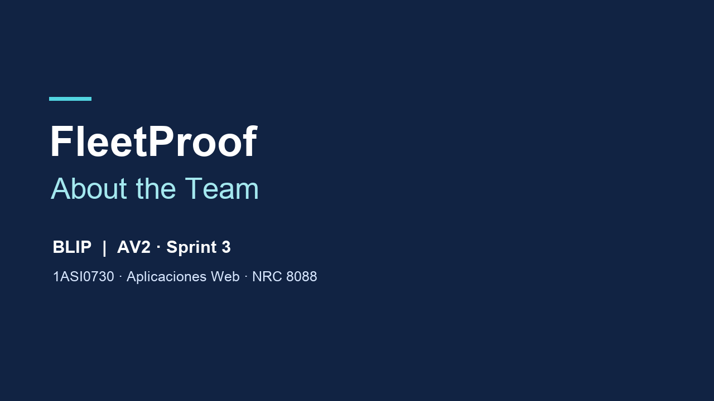

# Conclusiones

## Conclusiones y recomendaciones

### Conclusiones

El desarrollo de la primera entrega permitió establecer y delimitar el problema que FleetProof busca abordar: la verificación de información documentaria y administrativa de vehículos se realiza actualmente mediante consultas distribuidas entre diferentes fuentes, lo que dificulta consolidar resultados, conservar evidencias, comparar estados y realizar seguimiento de observaciones. Esta problemática se encuentra especialmente relacionada con empresas que administran flotas pequeñas y medianas, aunque también se identificó su presencia en propietarios, compradores y conductores independientes.

Los resultados obtenidos durante el Needfinding brindan evidencia inicial que respalda varios de los *User Assumptions* planteados. Las entrevistas muestran que los usuarios consultan diferentes fuentes, utilizan documentos, hojas de cálculo, capturas y mensajería para conservar o compartir información, y presentan dificultades para interpretar resultados dispersos o determinar quién debe atender una observación. En particular, las entrevistas de los segmentos empresarial y particular refuerzan la necesidad de centralizar información, conservar evidencia y facilitar el seguimiento de observaciones abiertas.

A partir de estos hallazgos, se mantiene como hipótesis de trabajo que FleetProof puede aportar valor al extender la consulta vehicular hacia un proceso de monitoreo recurrente. Sin embargo, en esta etapa todavía no es posible afirmar que los *Business Assumptions*, *Business Outcome Assumptions* y *Feature Assumptions* hayan sido validados. Por ejemplo, aún se requiere comprobar mediante pruebas controladas si funcionalidades como la importación mediante CSV, el checklist por fuente, la comparación de estados, el dashboard de riesgo, el seguimiento de observaciones y las alertas permiten mejorar las métricas planteadas. 

En relación con los *Hypothesis Statements*, se establecieron criterios de contraste cuantificables para orientar las siguientes etapas del proyecto. Estos incluyen comparar el tiempo de registro de una flota mediante CSV frente al registro manual, medir las omisiones durante la recopilación de información, evaluar el tiempo y precisión para identificar cambios y unidades prioritarias, y observar la proporción de observaciones que cuentan con responsable y evidencia de resolución. Asimismo, se plantea medir la oportunidad con la que los usuarios detectan situaciones relevantes mediante alertas.

Por tanto, los criterios de éxito definidos para FleetProof permanecen como objetivos de validación para las siguientes entregas: lograr un uso recurrente del monitoreo, reducir el tiempo requerido para preparar y revisar información vehicular, facilitar la identificación temprana de cambios relevantes y aumentar la proporción de observaciones que cuentan con seguimiento documentado. En AV1 estos criterios se consideran referencias de medición y no resultados concluyentes, debido a que todavía no se han realizado las pruebas de validación funcional necesarias para contrastarlos.

### Recomendaciones

Como siguiente paso, se recomienda profundizar el Needfinding y utilizar sus resultados para ajustar los *User Personas*, *User Journey Maps*, *Empathy Maps* y demás artefactos de UX. Posteriormente, las hipótesis deberán ser contrastadas mediante pruebas de tareas y validaciones con usuarios de los segmentos objetivo, registrando métricas comparables con el proceso actual.

En el desarrollo del producto se recomienda priorizar las funcionalidades relacionadas directamente con la propuesta de valor identificada: consolidación de información, trazabilidad de fuentes, generación de reportes, comparación de estados, identificación de unidades críticas y seguimiento de observaciones. Estas capacidades mantienen correspondencia con las User Stories y el Product Backlog definidos para FleetProof.

Finalmente, se recomienda mantener el carácter iterativo del proceso Lean UX. Los *Assumptions* y *Hypothesis Statements* deben actualizarse conforme se obtenga nueva evidencia, evitando considerar como validadas aquellas afirmaciones que todavía no hayan sido contrastadas con métricas o pruebas de usuarios. Para las siguientes entregas, el roadmap deberá orientarse progresivamente desde la validación del problema hacia la validación de la propuesta de valor, las funcionalidades principales y posteriormente la implementación completa de la solución.

### Conclusiones de AV2

En el Sprint 3 se integró la aplicación Vue con los servicios ASP.NET Core y PostgreSQL. Las pruebas de ejecución documentaron la activación del plan, el registro y la asignación de vehículos, y la persistencia de la asignación después de recargar. La landing publicada dirige a la aplicación de AV2.

Las sesiones guiadas aportaron dos prioridades: hacer visible la vigencia y cobertura de los datos por fuente, y distinguir el reporte puntual del seguimiento recurrente. Para la siguiente revisión se recomienda validar ambos recorridos en Vue sin asistencia, ampliar la muestra por segmento y medir si localizar el riesgo y revisar una placa requieren menos pasos.

## Video About-the-Team

### Resumen

El video presenta el trabajo del equipo BLIP en la entrega AV1 del curso Aplicaciones Web (1ASI0730, NRC 8088) sobre el producto FleetProof. Los integrantes exponen la startup y el producto, los segmentos objetivo y el proceso Lean UX, los artefactos de Needfinding del Capítulo II, la especificación de requisitos del Capítulo III, el diseño de producto y la arquitectura de software del Capítulo IV, la evidencia de desarrollo del Sprint 1 por integrante y las conclusiones de la entrega.

**Duración:** 21 min 54 s.

### Pauta de secuencias

| Momento | Contenido |
|---|---|
| 00:00 | Portada: curso Aplicaciones Web (1ASI0730), NRC 8088, docente y producto FleetProof. |
| 00:15 | Startup profile: misión y visión de BLIP, propuesta de valor y presentación de los integrantes. |
| 05:00 | Capítulo II: User Personas de los segmentos entrevistados (asesor automotor y responsable comercial) y hallazgos del Needfinding. |
| 10:00 | Capítulo III: Impact Mapping con el objetivo de negocio y su relación con las User Stories (US012, US013 y US015). |
| 11:40 | Capítulo IV: Style Guidelines con la paleta de colores, la tipografía y la navegación del producto. |
| 15:00 | Capítulo IV: arquitectura de software a nivel de Bounded Context. |
| 18:20 | Evidencia de desarrollo del Sprint 1: ramas de trabajo y capturas de commits de cada integrante. |
| 21:20 | Conclusiones de AV1: validación del problema, viabilidad de la solución, solidez metodológica del Lean UX y despliegue de la Landing Page en GitHub Pages. |

### Screenshot

### URL del video

[Video About-the-Team - AV1 (Google Drive)](https://drive.google.com/file/d/1FLNnxTZTzsK9Y0VTbScm8yhSiuJtYtqe/view?usp=sharing)

### AV2 · Sprint 3

Esta versión reúne cinco testimonios sobre el trabajo en FleetProof. El equipo explica cómo coordinó la integración entre la aplicación y el backend, revisó la arquitectura, preparó material audiovisual y organizó las correcciones de la entrega. Los testimonios relacionan esas actividades con el Student Outcome ABET 5: distribución del liderazgo, colaboración y verificación de objetivos compartidos.

**Archivo:** `upc-pre-202620-1asi0730-8088-blip-about-the-team-sprint-3.mp4`. **Duración:** 00:06:09.

| Inicio | Secuencia |
|---|---|
| 00:00:00 | Portada de FleetProof: BLIP, Aplicaciones Web, NRC 8088, AV2. |
| 00:00:04 | Sebastián Eduardo Reyes Limo: coordinación, integración de flotas y reportes por placa, y verificación del flujo después de recargar. |
| 00:01:26 | Harrison Hubert Payesa Torres: trabajo audiovisual, validaciones, monitoreo y coordinación con GitFlow. |
| 00:02:21 | Daniel Stalin Palomino Murga: diseño, diagramas de arquitectura, implementación y revisión de artefactos. |
| 00:03:41 | Sebastián Uriel Becerra Durand: documentación de arquitectura, trazabilidad de cambios y aprendizaje técnico. |
| 00:05:04 | Rodrigo Fernando Gómez De La Torre Huertas: correcciones en equipo y retrospectiva sobre organización y tiempos. |

[Video About the Team AV2 en Microsoft Stream](https://upcedupe-my.sharepoint.com/:v:/g/personal/u202311656_upc_edu_pe/IQAbbm_PwsF9Sqe3-cD1YA9HAZaLuQEnaHpzU96VtGrvscY?nav=eyJyZWZlcnJhbEluZm8iOnsicmVmZXJyYWxBcHAiOiJPbmVEcml2ZUZvckJ1c2luZXNzIiwicmVmZXJyYWxBcHBQbGF0Zm9ybSI6IldlYiIsInJlZmVycmFsTW9kZSI6InZpZXciLCJyZWZlcnJhbFZpZXciOiJNeUZpbGVzTGlua0NvcHkifX0&e=IXcbKr)
